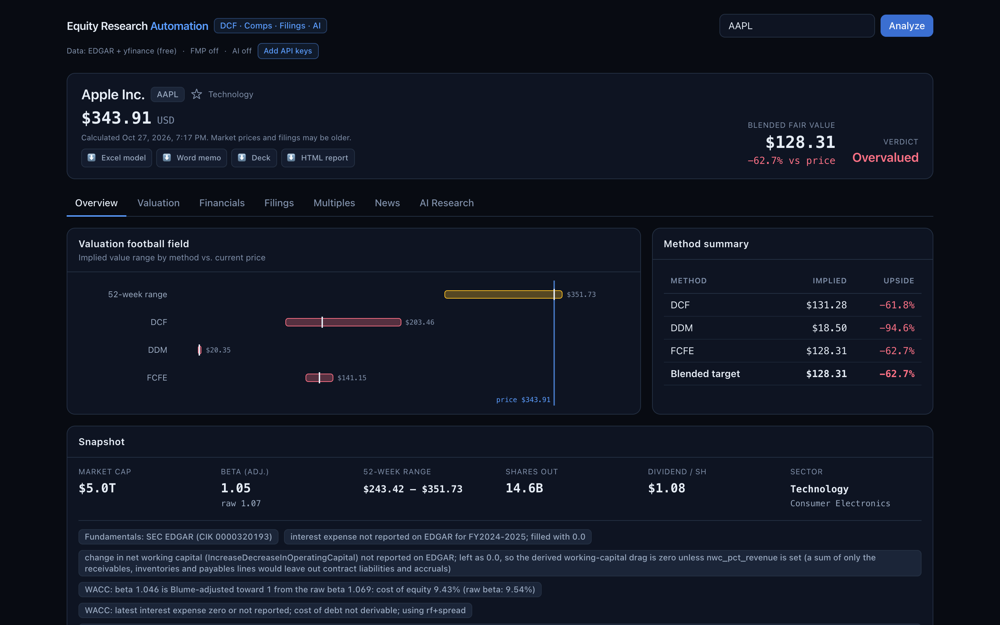
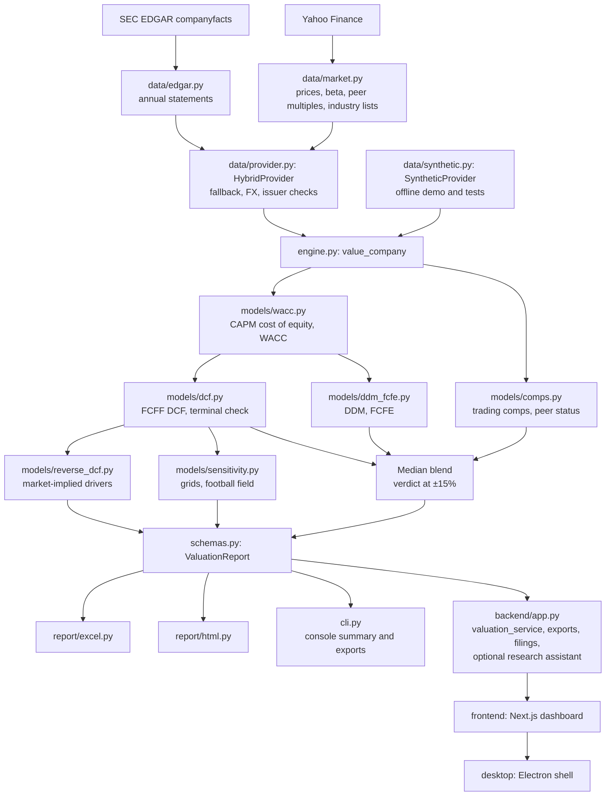
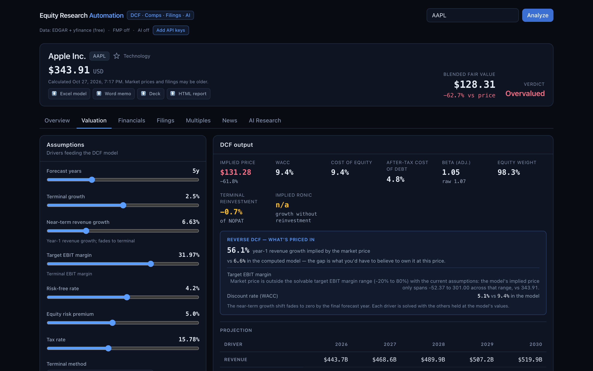

# Equity Research Automation

[](https://github.com/wcsmars/Equity-Valuation-Engine-with-Reverse-DCF/actions/workflows/tests.yml)

An equity valuation engine with a local research dashboard. It combines SEC
EDGAR fundamentals and Yahoo Finance market data, runs several valuation
methods, solves for what the share price implies, and exports the results to
Excel and HTML. The dashboard adds editable assumptions, filing analysis, saved
research, and Word/PowerPoint exports.



*Dashboard screenshots: AAPL on live data with the default inputs, captured for
the October 2026 release. Live figures change with the market; the
reproducible offline example is under [Results](#results).*

## Highlights

- **Valuation engine written from scratch** in `equity_valuation/`: FCFF DCF with a
  mid-year convention and a Gordon-growth, exit-multiple or value-driver terminal
  value, CAPM cost of equity and WACC on market-value weights, trading comps with
  per-multiple outlier trimming and a three-peer minimum per multiple, DDM and
  FCFE, two-way sensitivity grids, and a football-field summary.
- **Reverse DCF** (`equity_valuation/models/reverse_dcf.py`): solves for the
  year-1 revenue growth, the target EBIT margin and the discount rate that each
  reproduce the current share price with the other inputs held, so the model
  answers "what do I have to believe?" as well as "what is it worth?". Each
  range is scanned on a grid before bisecting, so a curve that is not monotone
  (extra revenue destroys value at a negative margin) gives its lowest solution
  and a note rather than a wrong answer. The growth change fades to zero by the
  last explicit year, preserving the computed path's shape and endpoint. The
  CLI summary, every export and the dashboard show the result.
- **Terminal-value check**: the first stable year is split into NOPAT and net
  reinvestment, so each Gordon or value-driver run reports the reinvestment rate
  and the return on new invested capital (RONIC) that its terminal growth
  implies, beside the latest ROIC (an exit-multiple terminal value does not
  project that year, so it reports none). Growth with no net reinvestment, or
  an implied RONIC above both 100% and three times the latest ROIC, gets a
  note. The opt-in value-driver terminal value, NOPAT x (1 - g / RONIC) /
  (WACC - g), ties reinvestment to a chosen RONIC.
- **Traceable peer sets**: every requested peer is reported as used, not found,
  without a usable multiple, or the target itself, and a note names the peers
  left out, so a mistyped ticker is not dropped silently. Peer suggestions from
  Yahoo's industry list (within a market-cap band) and a trailing-twelve-month
  comps basis are opt-in.
- **EDGAR data layer**: XBRL company facts are normalized into annual statements
  keyed by reporting period rather than the XBRL fiscal-year field, so restated
  figures win and companies that switched tags still get a complete series.
  Common filing quirks are corrected: a revenue tag that is only a sub-total
  gives way to the full total, segment profit tagged as operating income is
  replaced by revenue less total costs, share counts tagged in millions are
  rescaled, and a stock split after the latest annual report is applied to
  annual counts still on the old basis. yfinance supplies prices, beta, and
  peer multiples and is the fundamentals fallback. Everything sits behind a
  `DataProvider` interface, which is why the models run offline on synthetic
  companies in the tests.
- **Issuer-aware data checks**: EDGAR tags identify banks, insurers, REITs, BDCs,
  lenders, debt-funded lessors, and groups with a consolidated captive finance arm,
  whose FCFF models are shown for reference only. Statements reported in another
  currency are converted, multi-class share counts are reconciled, and stale or
  missing EDGAR lines (debt, D&A, capex) are filled from Yahoo with a note.
- **Data-quality checks**: missing model inputs produce notes in the dashboard
  and exports. A required exchange rate that cannot be obtained stops the run
  with a clear error; amounts in different currencies are never mixed in a valuation.
  After a corporate action that looks like a spin-off, the verdict is withheld
  until the next annual report.
- **Dashboard**: DCF, DDM and comps drivers are edited in place and applied on
  Recompute, with a bar listing the unapplied changes, a header badge listing
  every input that differs from the defaults, peer suggestions, and a line
  explaining any method left out of the blended target.
- **Packaging and CI**: an installable package with an `equity-valuation`
  command, a lint gate (syntax errors and pyflakes rules), a coverage gate, and
  a README test that runs the [Programmatic use](#programmatic-use) example and
  checks the documented figures, commands, thresholds and module map against
  the code.
- **Stack**: Python 3.11+ with pandas, requests, openpyxl, plotly, python-docx, and
  python-pptx; FastAPI; Next.js 15, React 19, TypeScript, and Tailwind; Electron;
  optional Anthropic API for the research assistant.

## Valuation workflow

| Component | Implementation |
| --- | --- |
| Data | EDGAR annual financials, yfinance prices and peer multiples; yfinance fundamentals (converted to the quote currency) when EDGAR has no usable or current US-dollar statements; debt, D&A and capex that EDGAR's tags miss are filled from Yahoo's statements with a note |
| DCF | Forecast FCFF, CAPM/WACC on a Blume-adjusted beta, Gordon-growth, exit-multiple or opt-in value-driver terminal value, enterprise-to-equity bridge; a Gordon or value-driver terminal year reports its reinvestment rate and implied return on new invested capital |
| Reverse DCF | Engine, CLI, exports and dashboard: the year-1 revenue growth, target EBIT margin and discount rate that each reprice the stock to the market, other inputs held; a grid scan, then bisection to within 0.0001% of the price |
| Comparables | Peer multiples (EV/EBITDA, EV/Sales, P/E, P/B), outlier trimming, median-based implied prices; P/E and P/B only for banks, insurers, lenders and BDCs (including mortgage REITs), captive-finance groups and debt-funded lessors, while equity REITs keep EV/EBITDA and EV/Sales. Peers are passed in, or suggested from Yahoo's industry list on request, and each one's status is reported. The multiples apply to the target's latest fiscal year, or on request its trailing twelve months. A multiple gives a price only from at least three peer values left after trimming; with one or two, its peer figures are shown but not priced. The EV multiples add the target's operating-lease liabilities from its filing to its EV and equity bridge, the basis of the peers' market EVs. PEG is informational because growth horizons differ |
| DDM / FCFE | Dividend (Gordon, two-stage or H-model) and equity cash-flow valuations discounted at cost of equity; the DDM counts regular and recurring variable dividends, not buybacks or one-off specials; the dashboard edits the DDM method, high-growth rate and years |
| Sensitivity | WACC/growth and margin/growth grids (exit-multiple columns for an exit-multiple terminal value; a value-driver run keeps its method and RONIC in every cell), plus valuation-range comparisons |
| Decision | Blended target = median of the implied prices from the methods that apply to the company (a method that could not value it is left out, and a negative equity value counts as zero); verdict is Undervalued at +15% upside or more, Overvalued at -15% or less, otherwise Fairly valued. When only the DDM is left for a bank, insurer, REIT, BDC or lender, its price is the target but no verdict is given; a captive-finance group or debt-funded lessor gets no target without comps. After a corporate action past the latest fiscal year that is not a plain split (likely a spin-off), the target is shown for reference without a verdict or upside |
| Research | Filing retrieval, notes, watchlist, optional source-linked AI summaries and assumption suggestions |
| Exports | Excel model, interactive HTML report, Word memo, PowerPoint briefing with paginated peer tables, research sections, sources, and model notes; every format carries the reverse DCF |

The median keeps one outlying method, such as a DDM on a low-payout stock, from
dragging the blended target. For banks, insurers, REITs, BDCs, lenders,
debt-funded operating lessors, and groups with a consolidated captive finance arm
(such as GM, Ford, Deere, and Caterpillar), the FCFF DCF and FCFE are shown for
reference only, because interest or leasing is part of their operations. For
captive-finance groups and debt-funded lessors the DDM is also reference-only
when its payout is below 40%, and it never sets the target on its own, so they
need peers (`--peers` or `--auto-peers`) to get a blended target. A flagged
company that reports no operating income gets no reference DCF price unless a
target EBIT margin is set. The engine does not solve the reverse DCF for these
issuers, since their FCFF DCF does not set the price; the dashboard still
inverts the reference-only DCF and labels it as such. The
data-provider interface lets the models run on supplied data independently of
the live APIs: `--demo` and the offline checks use a synthetic dividend-paying
company, and the checks add a distressed company to exercise negative equity
values.

## Architecture



The engine reads every company through the `DataProvider` interface, so the
same models run on live data, on the synthetic company in the tests, or on the
backend's cached copy while dashboard sliders move. `schemas.py` holds the
dataclasses the layers exchange; the CLI, the exporters and the API all consume
one `ValuationReport`.

## Run the valuation engine

Use Python 3.11 or newer. Run these commands from this directory. The `--demo`
run needs no network access or API keys:

```bash
python3 -m venv .venv
source .venv/bin/activate
python -m pip install --upgrade pip setuptools
python -m pip install -r requirements.txt
python -m equity_valuation --demo
```

To install the engine as a package instead, with an `equity-valuation` command
that runs the same CLI, plus the API and development tools, use
`python -m pip install -e '.[backend,dev]'`.

`--demo` values the synthetic company in `equity_valuation/data/synthetic.py`
against three synthetic peers, prints a summary that includes the reverse DCF,
and writes `output/SYNT_valuation.xlsx` and `output/SYNT_valuation.html`. For a
live ticker, set an EDGAR contact first:

```bash
export SEC_USER_AGENT='equity-research your.email@example.com'
python -m equity_valuation AAPL --peers MSFT,GOOGL,META,AMZN
```

Replace the example contact with your own before requesting EDGAR data. Comps
run on the peers passed with `--peers`; `--auto-peers` asks Yahoo's industry
list for suggestions instead, and without either, comps are skipped.
When `SEC_USER_AGENT` is not set in the environment, the CLI reads it from the
project `.env`, or from `.env` in the working directory when the project has
none (as after a regular, non-editable install); other `.env` settings are
loaded only by the dashboard scripts.
Without a contact, EDGAR is skipped and the valuation provider attempts its
yfinance fallback. No API key is needed for these two data sources.

```bash
python -m equity_valuation MSFT --peers AAPL,GOOGL,META,AMZN \
  --rf 0.043 --erp 0.05 --terminal-growth 0.025 --forecast-years 6
python -m equity_valuation NVDA --terminal-method exit_multiple \
  --exit-ev-ebitda 18 --html
python -m equity_valuation MSFT --peers AAPL,GOOGL,META,AMZN \
  --terminal-method value_driver --terminal-ronic 0.15
python -m equity_valuation KO --auto-peers --comps-basis ttm
python -m equity_valuation --help
```

`--auto-peers` applies only when `--peers` is omitted: it proposes up to eight
names from Yahoo's list for the target's industry, closest in market cap first,
and lists them in the notes for review. `--comps-basis ttm` applies the peers'
trailing multiples to Yahoo's trailing-twelve-month revenue, EBITDA and net
income for the target instead of its latest fiscal year, falling back to the
fiscal year with a note when those figures are missing, stale or in another
currency; the DCF stays on fiscal-year figures.
`--terminal-method value_driver` takes `--terminal-ronic`, a decimal above the
terminal growth; without it RONIC equals WACC, so growth adds no value.

Exports go to `output/` by default. Use `--out DIR` to choose another directory.
With no export flag both files are written; `--excel` or `--html` alone writes
only that format.
The Excel DCF sheet contains formulas for selected calculations; other model
outputs, including the terminal reinvestment check and the reverse DCF, are
snapshots. The HTML report embeds its chart library for offline use.
Rates are decimals (`--rf 0.043` means 4.3%); percent-style, non-finite or
out-of-range values are rejected. `--terminal-growth` applies to the DCF, DDM
and FCFE. The command exits 1 if an export fails or no requested model produces a usable
valuation, and 2 for invalid arguments. Diagnostic exports are still written
when the input data loads but every requested model is unavailable.

## Programmatic use

```python
import os

from equity_valuation import value_company
from equity_valuation.data.synthetic import DEMO_PEERS, SyntheticProvider
from equity_valuation.report.excel import write_excel
from equity_valuation.report.html import write_html

# The offline synthetic company. Without `provider` the engine reads SEC EDGAR
# and Yahoo Finance, e.g. value_company("MSFT", peers=["AAPL", "GOOGL", "META"]).
report = value_company("SYNT", provider=SyntheticProvider(), peers=DEMO_PEERS)
summary, implied = report.summary, report.reverse_dcf
print(f"{summary['blended_target']:.2f} {summary['recommendation']}")
print(f"year-1 growth {implied['implied_growth_y1']:.1%}, "
      f"target EBIT margin {implied['margin']['implied_target_ebit_margin']:.1%}, "
      f"discount rate {implied['wacc']['implied_wacc']:.1%}")

os.makedirs("output", exist_ok=True)
write_excel(report, "output/SYNT_valuation.xlsx")
write_html(report, "output/SYNT_valuation.html")
```

It prints:

```text
32.40 Overvalued
year-1 growth 17.5%, target EBIT margin 30.8%, discount rate 8.2%
```

`value_company` takes the CLI's inputs as keyword arguments (`macro`,
`dcf_assumptions`, `ddm_assumptions`, `peers`, `auto_peers`, `comps_basis` and
`run_*` toggles for each model). The `ValuationReport` it returns holds each
model's result (`dcf`, `comps`, `ddm`, `fcfe`, `sensitivities`,
`football_field`), the blended `summary`, `reverse_dcf` and `warnings`. The
README test runs this example as written.

## Run the dashboard

The dashboard also needs Node.js 22.12 or newer and npm.

```bash
test -f .env || cp .env.example .env
# Edit .env: set your SEC contact and any optional API keys.
./run_dev.sh
```

Open `http://127.0.0.1:3000`. The script installs Python dependencies, installs
frontend packages from the lockfile on first run, and starts FastAPI and Next.js.
Press Ctrl-C to stop both servers.

The Valuation tab edits the DCF drivers (including the value-driver terminal
value and its RONIC), the DDM method, high-growth rate and years, the peer set,
and the comps basis. Edits apply on Recompute: until then a bar lists each
unapplied change, with Recompute and Discard, and a **Custom inputs** badge in
the header lists every input that differs from the defaults, with a reset.
**Suggest peers** fills the peer box from Yahoo's industry list without applying
it. After a run each peer is marked as used, not found or without a usable
multiple, and each multiple shows how many peers it rests on. The reverse DCF
card shows the implied growth, margin and discount rate. When a method is left
out of the blend or no verdict is given, a line under the verdict says why and,
where peers would help, offers to add them. For banks and other flagged issuers
the DCF drivers are collapsed and marked reference-only, and where comps use
P/E and P/B only the Multiples tab marks the EV multiples as not meaningful.
A ticker that is not 1-12 letters, digits, dots or hyphens is refused before
any request, and one with no market data gets a message to check the symbol.

Dashboard exports use the exact displayed valuation, with its calculation time.
Each calculated report is retained in memory for up to 24 hours, limited to the
32 latest reports. Restarting the backend or exceeding those limits requires
Recompute before export; the app shows a conflict instead of silently refreshing
prices. Unsaved assumption changes take effect only after Recompute. Direct API
clients may omit `report_id` to calculate a new export from their payload.

FMP enrichment uses the stable API. Analyst revenue/EPS estimates use the
reporting currency when supplied by FMP; they carry no quote-currency symbol
when that currency is unknown. Missing models display as unavailable, while a
completed model that values equity at zero remains a zero estimate.



| Setting | Purpose |
| --- | --- |
| `SEC_USER_AGENT` | Application name and contact email for EDGAR requests |
| `FMP_API_KEY` | Optional Financial Modeling Prep news, estimates, ratios, transcripts, and suggested peers; coverage depends on the account plan |
| `ANTHROPIC_API_KEY` | Optional research summaries, chat, and research notes |
| `ANTHROPIC_MODEL` | Optional override of the model used by the research service |

The research assistant sends supplied text, PDFs, and valuation context to
Anthropic when invoked. Its suggestions require user review before applying
them to the model. Saved watchlists and notes stay in `data/copilot_store.json`;
that file, API keys, and generated exports are ignored by Git.

For manual startup after installing both Python requirement files and running
`npm ci` in `frontend/`:

```bash
set -a; source .env; set +a
.venv/bin/python -m uvicorn backend.app:app --host 127.0.0.1 --port 8000
# In another terminal:
cd frontend
npm run dev -- --hostname 127.0.0.1
```

A macOS Electron wrapper is in [desktop/](desktop/README.md). It runs the
backend with the project's `.venv` Python. Source runs serve the frontend with
Electron's bundled Node runtime; a packaged local app uses the Node executable
captured when it was built (`ERC_NODE_PATH` overrides either). It depends on
this checkout and is not a standalone distribution.

## Results

The offline demo is deterministic, so these figures reproduce exactly with
`python -m equity_valuation --demo` (the default inputs: risk-free rate 4.2%,
equity risk premium 5%, five forecast years, 2.5% terminal growth).
`tests/test_exports.py` pins them. Synthetic Corp's revenue grows 8% a year from
$80B in FY2020 to $108.8B in FY2024, the base year the models value from. It has
a 25% EBIT margin, a 30% payout, $12B of net debt, a beta of 1.1, and a share
price set at 20x trailing earnings.

| Method | Implied price | vs. $40.84 price |
| --- | ---: | ---: |
| DCF (FCFF, WACC 9.5%) | $33.38 | -18.3% |
| Comps (median of four peer multiples) | $46.96 | +15.0% |
| DDM | $10.99 | -73.1% |
| FCFE | $31.41 | -23.1% |
| **Blended target (median)** | **$32.40** | **-20.7%, Overvalued** |

Terminal value is 73% of the DCF enterprise value. The reverse DCF shows why the
model calls the stock expensive. Holding the other inputs fixed, the price
implies any one of:

| Driver | Model | Implied by $40.84 |
| --- | ---: | ---: |
| Year-1 revenue growth, fading to terminal | 8.0% | 17.5% |
| Target EBIT margin | 25.0% | 30.8% |
| Discount rate (WACC) | 9.5% | 8.2% |

The terminal year reinvests 6.7% of NOPAT to grow 2.5% a year, an implied return
on new invested capital of 37% against a latest ROIC of 30%, so the terminal
growth is paid for and no note is raised. `tests/test_reverse_dcf.py` and
`tests/test_terminal_value.py` pin these figures. The DDM sits far below the
other methods because it values only the 30% of earnings paid out as dividends,
which is the case the median guards against. These are model outputs on
made-up data, not a forecast or a track record.

## Offline checks

```bash
python -m pip install -r requirements.txt -r backend/requirements-backend.txt -r requirements-dev.txt
python -m tests.test_synthetic
python -m unittest discover -s tests -p 'test_*.py'
ruff check equity_valuation backend tests
cd frontend
npm ci
npm run typecheck
npm test
npm run build
cd ..
npm --prefix desktop test
```

`requirements-dev.txt` adds the pinned linter, coverage, `httpx2` (the API
tests' test client) and the setuptools the packaging test builds with.
`make test` runs both Python suites, and `make check` adds the lint and the
coverage gate that CI enforces.

The synthetic script checks WACC bounds, valuation identities, sensitivity
monotonicity, and ordered valuation ranges including negative-value cases. The
unittest suite pins the CAPM/WACC, DCF terminal-value, discounting,
equity-bridge, and DDM formulas on the synthetic company, checks the EDGAR
annual-series normalizer on a hand-built filing payload (restatements, tag
changes, 53-week years, non-annual forms), and checks settings persistence and
local-origin restrictions. The reverse-DCF tests check that each solved driver
reprices the stock to within 0.0001% of the price, and cover unsolvable ranges,
clamped inputs, flagged issuers and a solver failure. The terminal-value tests
check that the terminal FCFF equals NOPAT less net reinvestment, that the
value-driver terminal value equals the Gordon one at the implied RONIC and
NOPAT / WACC when RONIC equals WACC, and when each terminal note fires. The peer
tests cover suggestions from a mocked industry list (size band, widening, other
share classes, caching, failures) and each requested peer's status, including a
mistyped ticker; the comps-basis tests cover trailing figures that are stale,
no newer than the fiscal year or in another currency, per-metric fallback, and
the fiscal-year gap note. The export tests write the Excel, HTML, Word and PowerPoint outputs for
the synthetic company, confirm the demo figures above and the reverse DCF in
each format, and check that the solved growth reprices the stock to within one
cent. Further tests cover model edge cases (missing market cap, zero-filled
statement lines, negative book equity, clamped sensitivity cells, multiples
with too few peer values, a withheld verdict after a likely spin-off), that the
Excel formulas reconcile to the model, the CLI's input checks, the package
metadata and wheel contents, and the API: host checks, ticker and assumption
validation, peer suggestions, AI requests against a mocked client, and store
recovery.
`tests/test_readme_snippets.py` runs the [Programmatic use](#programmatic-use)
example and checks this README's demo figures, CLI commands, stated thresholds
(verdict bands, peer minimum, payout cut-off, solver tolerance, beta weights)
and module map against the code.
The EDGAR tests use hand-built filing payloads shaped like real filers (split
or partial D&A and capex tags, restricted cash, debt under several tags,
operating leases, foreign reporting currencies, banks, insurers, lessors, and
captive finance arms); the market-data tests also cover the Yahoo backfills of
missing debt, D&A and capex. The frontend tests cover the assumption
comparison behind the unapplied-changes bar
and the custom-inputs badge, peer status and sample sizes in the comps card, the
verdict explanation, the sensitivity-grid helpers, request ordering on ticker
switches, upload limits, recovery controls, accessibility, peer currencies, and
number formatting. Desktop tests cover startup failures, readiness timeouts,
interrupted builds, unique export paths, and stopping the servers when the app
is killed. These checks do not establish live data accuracy or investment
performance.

## Project layout

```text
equity_valuation/            Valuation engine (the installable package)
  cli.py                     Command line: flags, console summary, exports
  config.py                  Default assumptions and limits, SEC contact lookup
  engine.py                  value_company: data, models, blend, warnings
  schemas.py                 Dataclasses shared by every layer
  utils.py                   Numeric helpers, fades, issuer classification
  data/
    base.py                  DataProvider interface
    edgar.py                 SEC companyfacts to annual statements
    market.py                Yahoo prices, beta, peer multiples, peer suggestions
    provider.py              HybridProvider: EDGAR plus Yahoo, fallback, FX
    synthetic.py             Offline demo company and peers
  models/
    wacc.py                  CAPM cost of equity (Blume-adjusted beta), WACC
    dcf.py                   FCFF DCF and its terminal value methods
    reverse_dcf.py           Market-implied growth, margin and discount rate
    comps.py                 Trading comps, trimming, comps basis, peer status
    ddm_fcfe.py              Dividend discount model and FCFE
    sensitivity.py           Sensitivity grids and football field
  report/
    excel.py                 Excel workbook with live DCF formulas
    html.py                  Self-contained interactive HTML report
backend/                     FastAPI service for the dashboard
  app.py                     Routes, host and origin checks, request limits
  valuation_service.py       Request to engine inputs, data cache, peer suggestions
  serialization.py           ValuationReport to JSON, research context
  exports.py                 Excel, HTML, Word memo and PowerPoint exports
  filings.py                 EDGAR filing list and section extraction
  fmp_client.py              Optional Financial Modeling Prep enrichment
  ai_service.py              Optional research assistant (Anthropic API)
  store.py                   Watchlist and saved research
frontend/                    Next.js / React / TypeScript dashboard
  app/page.tsx               Page shell: search, tabs, recompute, custom inputs
  components/                Valuation, comps, DDM/FCFE, sensitivity, filings, research
  lib/                       API client, types, formatting, assumption comparison
  tests/                     Node test runner checks
desktop/                     Electron wrapper for local macOS use
tests/                       Offline Python checks, including the README test
pyproject.toml               Package metadata, console script, lint and coverage settings
Makefile                     test, demo, lint, coverage and check targets
```

This is a local, single-user research tool without authentication. The backend
accepts requests only for loopback hosts, refuses cross-site requests, caps
request sizes, and checks the ticker's format on valuation, export and
peer-suggestion requests before any data lookup.

### Data and model limitations

- **Data coverage.** Live data can be missing, stale, or rate-limited. Filers
  whose EDGAR US-dollar statements are missing, out of date, or only partial
  convenience translations (for example companies reporting in yuan or yen) use
  yfinance statements converted to the quote currency at one spot rate. If a
  required exchange rate is unavailable, valuation stops with a retry message.
  Peer market caps and enterprise values retain each peer's quote currency,
  labeled on the row. Common book equity excludes reported noncontrolling
  interests and preferred book capital. When EDGAR tags miss them, debt comes
  from Yahoo's balance sheet nearest the filing date, D&A from Yahoo's annual
  income or cash-flow statement (EBITDA is then recomputed where operating
  income is reported) and capex from Yahoo's annual cash flow. Yahoo covers
  about four years, so older gaps stay empty, and D&A or capex is not filled
  when Yahoo's figures do not match EDGAR's in the years both report. D&A and
  capex are the largest figures tagged for each year, never a sum, so they are
  lower bounds when a filer tags only parts of them. With no usable capex at
  all, capex is set equal to D&A with a warning. A newly registered holding
  company that took over an existing business can have no annual history on
  EDGAR yet; it is valued on Yahoo's statements (about four years), so its
  growth history can be short and unrepresentative.
- **Share count.** When Yahoo's share count and its market cap divided by the
  price are more than 5% apart, the engine uses market cap over price, which is
  right for multi-class issuers and ADRs; a data note gives both counts. The
  choice is not checked against the filings, so an issuer whose market cap
  Yahoo builds on a broader count gets too many shares: PCG reads about 3.0
  billion against about 2.2 billion outstanding, so its per-share DCF, FCFE and
  comps values come out roughly a quarter low and its WACC equity weight too
  high. An Up-C issuer (for example CVNA) divides its listed class's earnings
  by every unit, including those held outside that class.
- **Discount rate.** Default macro inputs are illustrative rather than current
  market estimates, and there is no country-risk premium. Yahoo betas are
  Blume-adjusted (0.67 x raw + 0.33); an unusable beta falls back to 1.0.
  Low-beta or highly levered companies can still get a WACC near 5-6% and a large
  terminal value, so check them with the WACC/growth grid.
- **Operating path.** The DCF holds the latest EBIT margin for the whole forecast.
  A one-off spike starts from the recent median, and a charge year or a collapse
  after a profitable run fades back toward the prior median, but a steady decline
  or a loss-making business is carried forward. Revenue growth fades from the
  historical rate to 2.5% over five years, so the default DCF is conservative for
  fast growers and tends to flag mega-cap growth names as overvalued. Historical
  growth includes acquisitions, whose cost is not in capex, so serial acquirers
  can read far above the price. Historical growth is measured from the first to
  the last filed year, so a history that spans a spin-off or reorganisation
  (older as-filed years next to restated ones) can show a much lower growth rate
  than the business has today; margin history can span such a change too.
  Capex well above D&A is treated as growth investment and phased down as
  growth fades, but not below 1.5x D&A, which is conservative for short-lived
  build-outs; a utility in a heavy build-out can still get a very low DCF.
- **Diagnostics.** The implied return on new invested capital is a diagnostic:
  a note flags terminal growth that the reinvestment drivers do not pay for, or
  pay for only at an implausibly high return, but the Gordon terminal value is
  unchanged and stays the default; the value-driver form is opt-in. A
  value-driver run's sensitivity cells use the same method and RONIC, and a
  growth column at or above an explicit RONIC is left blank. Each reverse-DCF
  figure moves one driver with the others held, so the three are alternatives,
  not a joint forecast.
- **Corporate actions.** When Yahoo records a corporate action after the latest
  fiscal year that is not a plain split (likely a spin-off), the statements may
  still include a business the company no longer owns, so the blended target is
  shown for reference with no verdict or upside until the next annual report.
  A factor below 1 is always flagged. A spin-off that Yahoo records only as a
  share ratio, or with a factor just above 1 (under about 1.05) while the share
  count barely moves, is not detected: it passes for a small stock dividend.
- **Other methods.** The DDM counts regular and recurring variable dividends
  and ignores buybacks and one-off specials, which understates banks and heavy
  repurchasers. Peers are not discovered by default; `--auto-peers` (or
  Suggest peers in the dashboard) proposes names from Yahoo's industry list,
  which covers only an industry's largest US names and can mix business
  models, so review them. When `FMP_API_KEY` is set and no
  peers were entered, the dashboard fills in up to eight of FMP's suggested
  peers once per ticker, as FMP lists them. By default comps apply peers'
  trailing multiples to the target's latest fiscal-year earnings, and a note
  flags trailing net income or EBITDA more than 15% away; `--comps-basis ttm`
  uses Yahoo's trailing figures for the target, which are not screened for
  one-off items, while the DCF stays on fiscal-year figures. P/E is dropped when
  the latest earnings are depressed by a one-off charge, and EV/EBITDA too when
  that charge sits inside operating profit. A multiple with fewer than three
  peer values left after the outlier trim gives no price, since one peer's
  multiple, or the mean of two, is not a peer median, so a captive-finance
  group or lessor with few usable peers gets no target. PEG is shown for
  context only: Yahoo's peer growth horizon is not consistently comparable with
  the target's historical diluted-EPS CAGR, so PEG produces no implied price and
  carries no weight in the blended target.

Use the rate, growth, and exit-multiple flags and the sensitivity grid to explore
the range. Review source data, peer selection, and assumptions before relying on
any valuation; model outputs and generated research are not investment advice.
